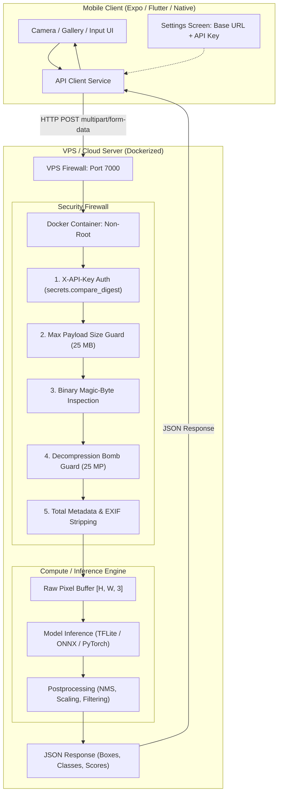

# Universal Mobile-Backend Deployment Blueprint & Security Checklist
> **Standard Architecture Guide for Thin-Client Mobile Apps with Dockerized ML/AI Backends on VPS**  
> *Applicable to: React Native / Expo, Flutter, Native Android (Kotlin), and iOS (Swift) clients paired with FastAPI/Python or Node inference backends.*

---

## 1. System Topology Overview

When building AI/ML-powered mobile applications, older or mid-range phones cannot reliably run heavy models (YOLO, Segment Anything, ResNet, Whisper, LLMs) on-device due to thermal throttling, memory limits, and battery drain. 

The industry standard pattern is the **Thin-Client / Edge-Compute Architecture**:



---

## 2. Universal File Structure & Readiness Checklist

Any repository adopting this architecture must verify the presence of the following standard files:

### Required Project Structure
```text
<project-root>/
├── update.sh                    # Universal one-click VPS deployment & update script
├── .gitignore                   # Must ignore .env files to prevent credential leakage
├── backend/
│   ├── .env.example             # Documented template for VPS environment variables
│   ├── .env                     # Secret local/VPS environment file (NEVER committed to git)
│   ├── Dockerfile               # Production multi-stage Dockerfile (non-root user)
│   ├── docker-compose.yml       # Service definition with ports, restart policy, healthcheck
│   ├── requirements.txt         # Pinned production Python dependencies
│   ├── model/                   # Model weight artifacts (.tflite, .onnx, or .pt)
│   └── app/
│       ├── main.py              # FastAPI app, CORS, /health, /api/v1/predict, error handlers
│       ├── config.py            # Environment settings and class/model mappings
│       ├── schemas.py           # Pydantic schemas strictly matching mobile client expectations
│       ├── services/
│       │   └── inference.py     # Clean model execution, letterboxing, and postprocessing
│       └── utils/
│           └── image.py         # Magic-byte check, EXIF orientation, and metadata stripping
└── mobile/ (or android/ / ios/)
    └── src/
        ├── services/api/
        │   ├── apiConfig.ts     # Dynamic Base URL & API Key management
        │   └── apiClient.ts     # Fetch wrapper injecting X-API-Key and handling timeouts
        └── features/settings/
            └── SettingsScreen   # User UI to enter VPS IP and API Key
```

### Readiness Verification Checklist
Use this checklist to audit any new project:

| Category | Requirement | Verification Command / Check |
|---|---|---|
| **Security** | Secret `.env` ignored by Git | `git status --ignored` shows `.env` ignored |
| **Security** | API Key authentication enforced | Header `X-API-Key` validated via `compare_digest` |
| **Security** | Non-image payloads blocked | Binary magic bytes verified before parsing |
| **Security** | Decompression bombs prevented | `Image.MAX_IMAGE_PIXELS` capped at 25 MP |
| **Security** | Metadata completely erased | Pillow image converted to raw NumPy array; PIL closed |
| **Security** | Container runs as non-root | `USER appuser` (UID 1000) defined in `Dockerfile` |
| **Container** | Healthcheck configured | `HEALTHCHECK` probing `/health` in Dockerfile |
| **Container** | Restart policy set | `restart: unless-stopped` in `docker-compose.yml` |
| **Automation**| One-click VPS update | `update.sh` backs up `.env`, pulls git, rebuilds |
| **Client** | Dynamic URL & Key configuration | Settings screen allows changing URL & API Key |

---

## 3. Security Implementation Standards (Raw Port Defense)

When exposing a port directly to the public internet (without a cloud reverse proxy), you must enforce defense-in-depth:

### A. Constant-Time API Key Authentication (`app/main.py`)
Standard string comparisons (`==`) leak timing information that allows attackers to guess keys byte-by-byte. Always use `secrets.compare_digest`:

```python
import os
import secrets
from typing import Optional
from fastapi import Depends, HTTPException, Security, status
from fastapi.security import APIKeyHeader

API_KEY = os.getenv("API_KEY", "").strip()
api_key_header = APIKeyHeader(name="X-API-Key", auto_error=False)

async def verify_api_key(api_key: Optional[str] = Security(api_key_header)):
    if not API_KEY:
        return True  # If API_KEY not set in development, allow open access
    if not api_key:
        raise HTTPException(
            status_code=status.HTTP_401_UNAUTHORIZED,
            detail="Missing required authentication header: X-API-Key",
            headers={"WWW-Authenticate": "ApiKey"},
        )
    if not secrets.compare_digest(api_key, API_KEY):
        raise HTTPException(
            status_code=status.HTTP_403_FORBIDDEN,
            detail="Invalid API key provided",
        )
    return True
```

### B. Magic-Byte Validation & Total Metadata Stripping (`app/utils/image.py`)
Never trust file extensions like `.jpg` or HTTP `Content-Type` headers. Verify binary signatures, trap decompression bombs, and wipe all EXIF/GPS metadata from RAM:

```python
import io
import cv2
import numpy as np
from PIL import Image, ImageOps

# Maximum allowed pixels (25 MP) prevents memory-exhaustion decompression bombs
MAX_PIXELS = 25_000_000
Image.MAX_IMAGE_PIXELS = MAX_PIXELS

ALLOWED_FORMATS = {"JPEG", "PNG", "WEBP"}

def validate_magic_bytes(header: bytes) -> str:
    if len(header) < 12:
        raise ValueError("File too small to contain valid image headers.")
    if header.startswith(b"\xff\xd8\xff"):
        return "JPEG"
    if header.startswith(b"\x89PNG\r\n\x1a\n"):
        return "PNG"
    if header.startswith(b"RIFF") and header[8:12] == b"WEBP":
        return "WEBP"
    raise ValueError("File content does not match allowed image signatures (JPEG, PNG, WebP).")

def load_and_sanitize_image(image_bytes: bytes) -> Tuple[np.ndarray, int, int]:
    # 1. Magic byte binary check
    validate_magic_bytes(image_bytes[:16])

    # 2. Decode under strict pixel cap
    pil_image = Image.open(io.BytesIO(image_bytes))

    if pil_image.format not in ALLOWED_FORMATS:
        pil_image.close()
        raise ValueError(f"Disallowed image format '{pil_image.format}'.")

    # 3. Safe EXIF orientation transpose with fallback
    try:
        pil_image = ImageOps.exif_transpose(pil_image)
    except Exception:
        pass  # Malformed EXIF tags ignored

    orig_w, orig_h = pil_image.size
    if orig_w < 32 or orig_h < 32 or orig_w > 8192 or orig_h > 8192:
        pil_image.close()
        raise ValueError(f"Image dimensions ({orig_w}x{orig_h}) out of safe bounds.")

    if pil_image.mode != "RGB":
        pil_image = pil_image.convert("RGB")

    # 4. Total metadata erasure: convert to raw NumPy pixel array [H, W, 3]
    # No EXIF, GPS, camera serials, or embedded strings survive this step
    image_rgb = np.array(pil_image, dtype=np.uint8)
    pil_image.close()

    return image_rgb, orig_w, orig_h
```

### C. Masking Internal Exceptions
Never return `str(e)` in 500 or 422 HTTP responses. Malicious users can analyze stack traces to discover VPS paths, Python versions, or directory trees:

```python
@app.exception_handler(Exception)
async def generic_exception_handler(_request, exc):
    logger.error("Internal unhandled error: %s", exc, exc_info=True)
    return JSONResponse(
        status_code=500,
        content={"detail": "An internal server error occurred. Please contact support."},
    )
```

---

## 4. Standard Docker Templates

### Production `Dockerfile` (`backend/Dockerfile`)
```dockerfile
FROM python:3.11-slim AS runtime

ENV PYTHONDONTWRITEBYTECODE=1 \
    PYTHONUNBUFFERED=1 \
    PORT=7000 \
    HOST=0.0.0.0

RUN apt-get update && apt-get install -y --no-install-recommends \
    curl \
    libglib2.0-0 \
    && rm -rf /var/lib/apt/lists/*

WORKDIR /app

COPY requirements.txt .
RUN pip install --no-cache-dir --upgrade pip && \
    pip install --no-cache-dir -r requirements.txt

COPY model/ ./model/
COPY app/ ./app/

# Security: Run as non-root user
RUN useradd -m -u 1000 appuser && \
    chown -R appuser:appuser /app
USER appuser

EXPOSE 7000

HEALTHCHECK --interval=30s --timeout=5s --start-period=10s --retries=3 \
    CMD curl -f http://localhost:7000/health || exit 1

CMD ["uvicorn", "app.main:app", "--host", "0.0.0.0", "--port", "7000", "--workers", "2"]
```

### Production `docker-compose.yml` (`backend/docker-compose.yml`)
```yaml
services:
  backend-service:
    build:
      context: .
      dockerfile: Dockerfile
    image: ml-inference-backend:latest
    container_name: ml-backend
    restart: unless-stopped
    ports:
      - "7000:7000"
    environment:
      - HOST=0.0.0.0
      - PORT=7000
      - API_KEY=${CARDD_API_KEY:-}
      - MAX_IMAGE_SIZE_BYTES=26214400
    deploy:
      resources:
        limits:
          cpus: "4.0"
          memory: 2G
    healthcheck:
      test: ["CMD", "curl", "-f", "http://localhost:7000/health"]
      interval: 20s
      timeout: 5s
      retries: 3
      start_period: 10s
```

---

## 5. Universal Automation Script (`update.sh`)

Place this script in the root of the repository. It completely eliminates manual VPS deployment steps:

```bash
#!/usr/bin/env bash
set -euo pipefail

GREEN='\033[0;32m'
BLUE='\033[0;34m'
YELLOW='\033[1;33m'
RED='\033[0;31m'
NC='\033[0m'

SCRIPT_DIR="$(cd "$(dirname "${BASH_SOURCE[0]}")" && pwd)"
ROOT_DIR="$SCRIPT_DIR"

if [[ ! -d "$ROOT_DIR/.git" && -d "$SCRIPT_DIR/../.git" ]]; then
  ROOT_DIR="$(cd "$SCRIPT_DIR/.." && pwd)"
fi

cd "$ROOT_DIR"
echo -e "${BLUE}[INFO]${NC} Running update in: $ROOT_DIR"

CURRENT_BRANCH="$(git rev-parse --abbrev-ref HEAD 2>/dev/null || echo "main")"
[[ "$CURRENT_BRANCH" == "HEAD" || -z "$CURRENT_BRANCH" ]] && CURRENT_BRANCH="main"

# 1. Back up secret .env so git reset never deletes API keys
TEMP_ENV=""
if [[ -f "$ROOT_DIR/backend/.env" ]]; then
  TEMP_ENV="$(mktemp)"
  cp "$ROOT_DIR/backend/.env" "$TEMP_ENV"
fi

# 2. Fetch and hard reset to remote
git fetch origin "$CURRENT_BRANCH"
git reset --hard "origin/$CURRENT_BRANCH"
git clean -fd -e backend/.env -e .env

# 3. Restore preserved .env
if [[ -n "$TEMP_ENV" && -f "$TEMP_ENV" ]]; then
  cp "$TEMP_ENV" "$ROOT_DIR/backend/.env"
  rm -f "$TEMP_ENV"
fi

# 4. Rebuild and launch Docker containers
cd "$ROOT_DIR/backend"
DOCKER_CMD="docker compose"
docker compose version >/dev/null 2>&1 || DOCKER_CMD="docker-compose"

$DOCKER_CMD build --pull
$DOCKER_CMD up -d

# 5. Automated health check verification
HEALTH_URL="http://localhost:7000/health"
IS_HEALTHY=0
for ((i=1; i<=15; i++)); do
  if curl -s -f "$HEALTH_URL" >/dev/null 2>&1; then
    IS_HEALTHY=1
    break
  fi
  sleep 2
done

if [[ "$IS_HEALTHY" -eq 1 ]]; then
  echo -e "${GREEN}[OK] Update successful and container is healthy!${NC}"
  echo -e "${GREEN}[OK] Latest commit: $(git log -1 --pretty=format:'%h - %s')${NC}"
else
  echo -e "${RED}[ERROR] Container failed healthcheck. Last logs:${NC}"
  $DOCKER_CMD logs --tail 30
  exit 1
fi
```

Make it executable:
```bash
chmod +x update.sh
```

---

## 6. Mobile Application Integration Contract

The mobile app must never hardcode server URLs or API keys into source code. Always follow these rules:

1. **Settings Screen Integration**:
   - Provide an input for **Backend URL** (`http://<VPS_IP>:7000`).
   - Provide a secure input for **API Key** (`secureTextEntry`).
   - Store both in persistent device storage (AsyncStorage, SecureStore, or SharedPreferences).
2. **API Client Header Injection**:
   Every HTTP request must inject the API Key dynamically:
   ```typescript
   const headers: Record<string, string> = {};
   const apiKey = getApiKey();
   if (apiKey) {
     headers['X-API-Key'] = apiKey;
   }
   ```
3. **Connection Testing**:
   Include a "Test Connection" button calling `GET /health` before the user attempts an inspection to provide instant feedback if the VPS IP is incorrect or firewall is blocked.

---

## 7. Standard Verification Test Suite (`curl`)

Once a backend is deployed on a VPS, run these four standard verification tests from your laptop terminal to prove security and functionality:

```bash
VPS_IP="88.222.212.15"
PORT="7000"
API_KEY="your_api_key_here"

# Test 1: Health check (Expected: 200 OK)
curl -s http://${VPS_IP}:${PORT}/health | jq

# Test 2: Missing API Key (Expected: 401 Unauthorized)
curl -s -o /dev/null -w "Status: %{http_code}\n" -X POST http://${VPS_IP}:${PORT}/api/v1/detect \
  -F "image=@sample.jpg"

# Test 3: Invalid API Key (Expected: 403 Forbidden)
curl -s -o /dev/null -w "Status: %{http_code}\n" -X POST http://${VPS_IP}:${PORT}/api/v1/detect \
  -H "X-API-Key: wrong_key" \
  -F "image=@sample.jpg"

# Test 4: Fake Image Payload (Expected: 422 Unprocessable Entity)
echo "malicious data" > /tmp/fake.jpg
curl -s -o /dev/null -w "Status: %{http_code}\n" -X POST http://${VPS_IP}:${PORT}/api/v1/detect \
  -H "X-API-Key: ${API_KEY}" \
  -F "image=@/tmp/fake.jpg"

# Test 5: Legitimate Prediction (Expected: 200 OK + Detections JSON)
curl -s -X POST http://${VPS_IP}:${PORT}/api/v1/detect \
  -H "X-API-Key: ${API_KEY}" \
  -F "image=@sample.jpg" | jq
```

---

## 8. Summary Checklist for Any New Project

When applying this blueprint to your next project:
1. Copy `Dockerfile`, `docker-compose.yml`, and `update.sh`.
2. Copy `app/utils/image.py` for standard magic-byte, decompression-bomb, and metadata-stripping security.
3. Configure `API_KEY` authentication in `app/main.py`.
4. Create `.env` on your VPS and open the firewall port (`sudo ufw allow <PORT>/tcp`).
5. Run `./update.sh` whenever new changes are pushed.
